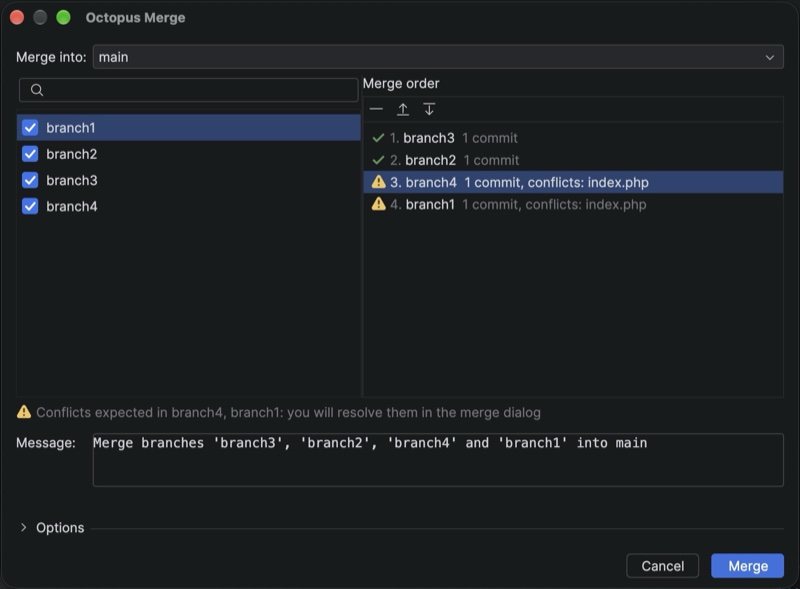
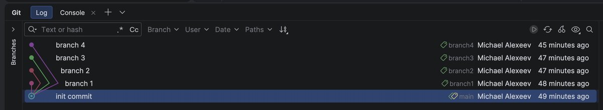
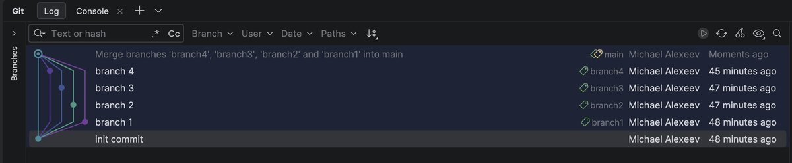

# Octopus Merge

JetBrains IDE plugin: merge several Git branches into one with a single merge commit
(an octopus merge), with conflict preview and conflict resolution in the IDE merge dialog.



Before: four branches off `main`.



After: one merge commit on `main` whose parents are the target and all four branches.



## Install

1. Download `JetbrainsOctopusMerge-<version>.zip` from the [latest release](https://github.com/michaelalexeevweb/jetbrains-octopus-merge/releases/latest).
2. Settings → Plugins → ⚙ → Install Plugin from Disk… → choose the zip → restart the IDE.

Requires an IntelliJ-based IDE 2026.3 or newer (build 263+) with the bundled Git plugin.

## Where

Look for the octopus button :

- **Git → Octopus Merge…** (right after Merge…)
- Main toolbar at the top of the IDE window, next to the run and search buttons
- Git tool window (`⌘9` on macOS, `Alt+9` on Windows/Linux): branches toolbar, and the context menu
  of selected branches or commits. The selection is pre-checked.
- Branch popup (current branch name on the main toolbar)
- Find Action (`⇧⌘A` / `Ctrl+Shift+A`): type `Octopus`

## Dialog

- **Repository** (several repositories in the project) and **Merge into** (target branch): type to get suggestions.
  **Branches**: checkbox list with search (local and remote).
- Search everywhere in the dialog: every typed word anywhere in the name, case-insensitive,
  and text typed in the wrong keyboard layout still matches (`ьфшт` finds `main`).
- **Merge order**: checked branches in order, reorder with ↑/↓. Each branch shows a preview:
  commits it brings, conflicts expected at its position (computed with `git merge-tree`, nothing is touched),
  or "already merged".
- **Resolve in advance**: double-click a branch with expected conflicts (or press Enter). The IDE merge window
  opens on in-memory copies; the branch turns ✓ "resolved in advance" and the merge applies your result without
  stopping. A resolution is tied to the exact conflict (same file, same three versions): after reordering or a branch
  update it is not used and you are asked again.
- **Message**: follows the selection until edited.
- **Options** (remembered):

| Option | Effect |
|---|---|
| On conflict | resolve in the merge dialog / keep target (`-X ours`) / take branch (`-X theirs`) |
| Stash local changes | stash before, restore after; on failure changes come back too |
| `--no-commit` | stage the result with `MERGE_HEAD` listing every branch; commit from the Commit tool window |
| `--log` | list merged commits in the message |
| `--signoff`, `-S` | Signed-off-by trailer, GPG signature |
| `--no-verify` | skip `pre-merge-commit` / `commit-msg` hooks |
| `--allow-unrelated-histories` | merge branches with no common history |
| Delete merged branches | delete merged local branches after the commit |

## How it merges

1. Branches already contained in the target or in another selected branch are skipped.
2. Native `git merge` with all branches (octopus strategy). Done if nothing conflicts.
3. Otherwise branches are merged one by one; conflicts resolved in advance are applied, the rest open the IDE merge dialog.
   The step commits are then replaced by one commit (`git commit-tree`) whose parents are the target
   and every branch: the same history an octopus merge gives. Hooks run as for a normal merge.
4. Cancel or failure restores the target, the checked-out branch and stashed changes.

The success notification has **Undo** (reset to the previous commit, recreate deleted branches);
a prepared `--no-commit` merge has **Commit…** and **Abort**.

## Reporting problems

- An error of the plugin in the IDE error dialog (red icon in the status bar): **Report to Octopus Merge on GitHub**.
- A failed merge or undo: **Report a problem…** in the notification.
- Anything else: the **Report a problem or suggest a feature** link on the plugin page
  (Settings → Plugins → Octopus Merge) opens a [new issue](https://github.com/michaelalexeevweb/jetbrains-octopus-merge/issues/new).

The first two open a prefilled [GitHub issue](https://github.com/michaelalexeevweb/jetbrains-octopus-merge/issues) in the browser
with the error and the IDE, plugin and OS versions. The plugin sends nothing itself: review the text and submit it.
For more detail attach the log: Help → Collect Logs and Diagnostic Data. Git commands are logged at debug level:
Help → Diagnostic Tools → Debug Log Settings → `#octopusmerge`.

## Build

Needs the IDE to build against: `localIdePath` in `gradle.properties`. `make` runs Gradle on that IDE's bundled JBR,
whatever `JAVA_HOME` says.

```bash
make check          # ktlint + tests (core on real git repositories, IDE integration) + Plugin Verifier + plugin zip
make release-check  # before tagging: clean tree, new version, change-notes and docs images in place, then check
make format         # fix Kotlin formatting (Kotlin coding conventions, see .editorconfig)
make run            # sandbox IDE with the plugin
```

User-visible texts live in `src/main/resources/messages/OctopusMergeBundle.properties`.
